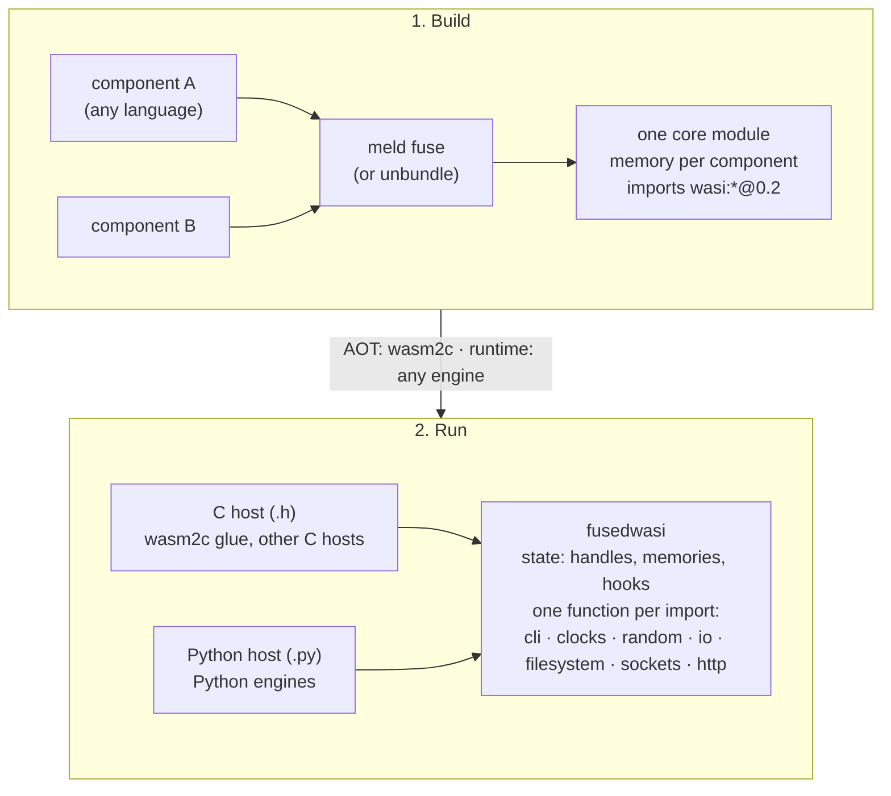

# fusedwasi

Header-only C host for the WASI Component Model, for core modules fused from components (wasm2c and other C hosts), with a Python twin.

**Alpha: nothing is released yet.** Two hosts, each as C headers (and the one of 0.2 with a Python twin):

* **WASI 0.2** (`fusedwasi/p2/`, `fusedwasi.p2`): all 200 imports of the command world and of `wasi:http`, in C and in Python, with the tests that run the same scenario in both and compare the outputs (POSIX and Windows).
* **WASI 0.1** (`fusedwasi/p1/`, `fusedwasi.p1`): `wasi_snapshot_preview1` and `wasi_unstable`, in C and in Python (`fusedwasi.p1.wasi_p1`, `wasi_p1_unstable`; the sockets are the four calls that answer NOTSOCK, since a program of 0.1 cannot make one). **WASI 0.1 is implemented over WASI 0.2, as Wasmtime does it: there is one state and one guest for both families.** The arguments, the environment, the standard streams, the preopens, the clocks, the random bytes and the sleep are the fields of the one `fusedwasi_p2_state`; the memory of an instance of 0.1 is memory 0 of its `fusedwasi_p2_guest`; a file or a directory opened by a module of 0.1 is a `descriptor` in the table of that state, the same resource a module of 0.2 sees in it, and the functions of 0.1 work through the operations of 0.2 (`fusedwasi_p2_fs_*`; in Python the methods of `State.filesystem`). What 0.1 keeps for itself: the rights of each descriptor, its position, the name of a preopen, and the errno table. A function of 0.1 traps like one of 0.2 (`g->trap`); the end of a call is the guest's (`proc_exit` is `wasi:cli/exit`: it leaves `exited` and `exit_code` there); `proc_raise` asks the hook `signal` of the guest and answers NOTSUP without one. The Python twin is checked against the C: the same script of calls (`tests/data/p1/*.txt`) is run by a C driver and by Python, and the lines they print are compared; the official wasi-testsuite of 0.1 runs through `tests/neutral`.

## The idea

A tool such as `meld fuse` turns a composed component into **one core module**: a memory for each component, the adapters between them are plain wasm, and the imports are the flat core form of `wasi:*` functions. Such a module needs only a host that implements those imports. `fusedwasi` is that host and nothing else: no engine, no component parser, no canonical ABI between components (the fuse already built it in).



**AOT and runtime.** The library asks the engine for two things only: the memory of each component (a base and a size) and a way to call a function for each import. So it does not matter how the module runs: compiled ahead of time to C with `wasm2c` (the C headers are included into the generated glue, nothing is needed at run time), or in an interpreter or a JIT that calls the same functions through its import table (the C headers from an embedder, the Python twin from a Python host). Only the AOT route has been run so far (wasmext, `wasm2c`); the runtime route follows from the interface and is not tested.

## The API (planned; the shape of the current code)

A **state** (the world), a **guest** (the caller), one flat function per import, the same arguments in C and in Python. The state holds what the guests share: the configuration, the tables of handles, the policies, the clocks. A guest holds what is one call's: the memory, the trap, the `cabi_realloc`, the end of the call (`exited`, `exit_code`). Many guests may point to one state, and nothing is rebound per call. The first argument of every function is the guest (`g` in C, `guest` in Python); its state is `g->state`. **Every C name has the prefix of the library** (`fusedwasi_` for functions and types, `FUSEDWASI_` for macros, then `p2_` for WASI 0.2): the headers are included into the C of other projects, so nothing may meet a name of the system, of another WASI host or of the user. The function of an import is `fusedwasi_` + the name that the Python twin has (`wasi_cli_environment_get_arguments`). The host gives the state what it decides (arguments, preopened directories, which sockets are allowed, the standard streams) and each guest its memory and its trap; the rest is the library.

```c
#include "wasi_p2_cli.h"             /* or wasi_p2_filesystem.h, wasi_p2_sockets.h, ... */

fusedwasi_p2_state state;            /* the world: made once, freed once, shared by the guests */
fusedwasi_p2_init(&state);           /* defaults: system clocks, /dev/urandom, nothing allowed in sockets */
state.args = args, state.arg_count = 2;

fusedwasi_p2_guest g;                /* the caller: one for each instance, made once */
fusedwasi_p2_guest_init(&g, &state); /* defaults: a trap that aborts, a wait, an exit that records and traps */
g.realloc = my_cabi_realloc;         /* the cabi_realloc of component `comp` */
g.trap = my_trap;                    /* a function that does not return: a longjmp, or what the engine has */
fusedwasi_p2_bind_memory(&g, 0, &m->data, &m->size);  /* once for each component: read at each call, so memory.grow needs no rebind */
/* or, as a convenience that keeps its own copy (set it again when the memory grows): fusedwasi_p2_set_memory(&g, 0, base, size); */

/* the body of an import of the module: the first argument is the guest, then the component whose memory it is */
fusedwasi_wasi_cli_environment_get_arguments(&g, /*comp*/ 0, /*retptr*/ ptr);

fusedwasi_p2_free(&state);           /* after the guests are done with it */
```

```python
from fusedwasi.p2 import Guest, State  # the same State and Guest serve WASI 0.1 (fusedwasi.p1.State is this class)
from fusedwasi.p2 import wasi_p2_cli as cli  # the module names follow the C headers

state = State(args=["prog"])  # the world: files, sockets, the clocks
guest = Guest(
    state, [memory], realloc=my_cabi_realloc
)  # a memory is any writable buffer, or a function of no arguments that gives it (followed when it moves)
cli.wasi_cli_environment_get_arguments(guest, 0, ptr)
```

The streams and pollables belong to the state: they take the state, never a guest, and never trap (a failure is a return value), so they can be made while the state is configured, before any guest exists:

```c
fusedwasi_p2_fd_stream *out = fusedwasi_p2_fd_output_new(&state, 1);   /* NULL when there is no memory */
state.std[1] = &out->base;
```

For 0.1 the same two parts, the same types: a function is `fusedwasi_p1_<name>(&g, ...)` with the guest `g` of 0.2 (`#include "wasi_p1.h"`; the memory of the instance is `fusedwasi_p2_bind_memory(&g, 0, ...)`), it answers the errno of WASI and traps through `g.trap`. The descriptors of 0.1 are made by the first call of a function of 0.1, or by `fusedwasi_p1_open_descriptors(&state, &err, &bad)`, which tells a preopen that cannot be opened; `fusedwasi_p2_free` frees them. In Python `fusedwasi.p1.State`, `Guest` and `Exit` are the classes of `fusedwasi.p2` (`guest = Guest(state, memory)` with one memory for an instance of 0.1) and `fusedwasi.p1.wasi_p1.fd_write(guest, ...)` is the call; `State(filesystem=...)` gives the files behind both families (Python only). `fusedwasi.signatures.find_import(module, name)` gives, for an import of a core module (of 0.1, or of any `0.2.N`), the row of the table of signatures with the C symbol, the Python function (`python_function()`) and whether it takes the number of the memory (`takes_comp`).

| Part | What the host gives | What the library does |
|---|---|---|
| memory (of the guest) | a base and a size for each component, bound by pointer (`fusedwasi_p2_bind_memory`, primary: read at each access, so a moved base is followed) or set by value (`fusedwasi_p2_set_memory`, the convenience) | checked, little-endian loads and stores; a pointer outside is a trap |
| handles | nothing | the table of `own` and `borrow` (generation + index), `[resource-drop]` |
| lists and strings it returns | `realloc` of the guest (the `cabi_realloc` of the component) | placing them in the guest's memory |
| files | the preopened directories (`path`, `name`, `writable`); Python: optionally `filesystem=` | paths confined below the preopen (POSIX and Windows) |
| sockets | `socket_addr_check`, `allow_ip_name_lookup`; refused by default | TCP, UDP, name lookup (POSIX and Winsock) |
| http | `http_check`, `http_send`; refused by default | an HTTP/1.1 client of its own (TLS in Python only), the types of `wasi:http` |
| time, random (state); trap, exit, wait, signal (guest) | a hook, or the system's own | the rest |

**Integers are unsigned**, parameters and results, in C (`uint32_t`, `uint64_t`) and in Python: an offset, a length or a handle is 0 to 2**32 - 1, an `i64` 0 to 2**64 - 1. An engine that hands its values over as signed (the Python bindings of wasmtime and wasm3 do) masks every argument by its width (`x & 0xFFFFFFFF`, `x & 0xFFFFFFFFFFFFFFFF`) and re-signs a result if it wants the range of its own type (`x - 2**32 if x >= 2**31`); the functions do not do it, and a negative offset is outside the memory.

Every function is `static inline` and nothing is global or thread-local, so a module links only what it imports and several instances (and several guests of one state) can live in a process.

## The headers come with the Python package

`pip install fusedwasi` (or a dependency on it) gives the headers too: `python -m fusedwasi` prints the directory to put on the include path, `fusedwasi.get_include()` gives it in Python, and the C is then `#include <fusedwasi/p2/wasi_p2_cli.h>`. With CMake: `find_package(fusedwasi)` and the target `fusedwasi::headers`. The headers in the wheel and in the CMake install are the same files (`src/fusedwasi/include/`).

## Who uses it

Any host that can give a memory and call a function for each import. In C: the glue of a module compiled with `wasm2c` includes the headers and needs nothing at run time. In Python: the twin in `.py` under the engines a Python host supports. The two users that exist today are `wasmext` (C) and `wasmhost` (Python); neither is special, and the library knows nothing of them.

## Not here

Components made of components (the fuse does that), WASI 0.3 and async, an engine, a parser of WIT.

WASI 0.3 is not supported. If it is ever added through `meld fuse`, the support will be **partial**: meld 0.65 does not keep the async part of the canonical ABI (the `[async-lower]` imports are renamed or replaced by meld-private ones, two fused async components leave a dangling import, `--component` refuses async). Full p3 waits until meld keeps the standard async ABI.
