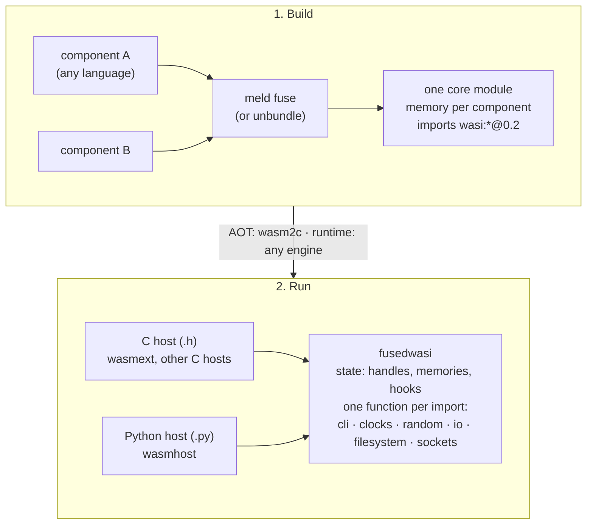

# fusedwasi

Header-only C host for the WASI Component Model, for core modules fused from components (wasm2c and other C hosts), with a Python twin.

**Placeholder: nothing is released yet.** What follows is the idea and the shape of the API, taken from the code that is to move here (the WASI 0.2 host of `wasmext`: `c/p2/*.h` and `p2/*.py`).

## The idea

A tool such as `meld fuse` turns a composed component into **one core module**: a memory for each component, the adapters between them are plain wasm, and the imports are the flat core form of `wasi:*` functions. Such a module needs only a host that implements those imports. `fusedwasi` is that host and nothing else: no engine, no component parser, no canonical ABI between components (the fuse already built it in).



**AOT and runtime.** The library asks the engine for two things only: the memory of each component (a base and a size) and a way to call a function for each import. So it does not matter how the module runs: compiled ahead of time to C with `wasm2c` (the C headers are included into the generated glue, nothing is needed at run time), or in an interpreter or a JIT that calls the same functions through its import table (the C headers from an embedder, the Python twin from a Python host). Only the AOT route has been run so far (wasmext, `wasm2c`); the runtime route follows from the interface and is not tested.

## The API (planned; the shape of the current code)

One state, one flat function per import, the same names and arguments in C and in Python. The host gives the state what it decides (arguments, preopened directories, which sockets are allowed, the standard streams, a trap); the rest is the library.

```c
#include "wasi_p2_cli.h"             /* or wasi_p2_filesystem.h, wasi_p2_sockets.h, ... */

wasi_p2_state s;
wasi_p2_init(&s);                    /* defaults: system clocks, /dev/urandom, nothing allowed in sockets */
s.args = args, s.arg_count = 2;
s.realloc = my_cabi_realloc;         /* the cabi_realloc of component `comp` */
s.trap = my_trap;                    /* in a wasm2c module: wasm_rt_trap */
wasi_p2_set_memory(&s, 0, base, size);       /* once for each component; set again when the memory grows */

/* the body of an import of the module: the first argument is the component whose memory it is */
wasi_cli_environment_get_arguments(&s, /*comp*/ 0, /*retptr*/ ptr);
```

```python
from fusedwasi import Host, wasi_p2_cli as cli     # the module names follow the C headers

host = Host([memory], args=["prog"], realloc=my_cabi_realloc)   # a memory is any writable buffer
cli.wasi_cli_environment_get_arguments(host, 0, ptr)
```

| Part | What the host gives | What the library does |
|---|---|---|
| memory | a base and a size for each component | checked, little-endian loads and stores; a pointer outside is a trap |
| handles | nothing | the table of `own` and `borrow` (generation + index), `[resource-drop]` |
| lists and strings it returns | `realloc` (the `cabi_realloc` of the component) | placing them in the guest's memory |
| files | the preopened directories (`path`, `name`, `writable`) | paths confined below the preopen (POSIX) |
| sockets | `socket_addr_check`, `allow_ip_name_lookup`; refused by default | TCP, UDP, name lookup (POSIX) |
| time, random, exit, wait | a hook, or the system's own | the rest |

Every function is `static inline` and nothing is global or thread-local, so a module links only what it imports and several instances can live in a process.

## Who uses it

- **wasmext** (C, through `wasm2c`): the glue of a module includes the headers; no Python at run time.
- **wasmhost** (Python): the twin in `.py` under the engines it supports.
- **Any other host** that can give a memory and call a function for each import.

## Not here

Components made of components (the fuse does that), WASI 0.3 and async, an engine, a parser of WIT.
