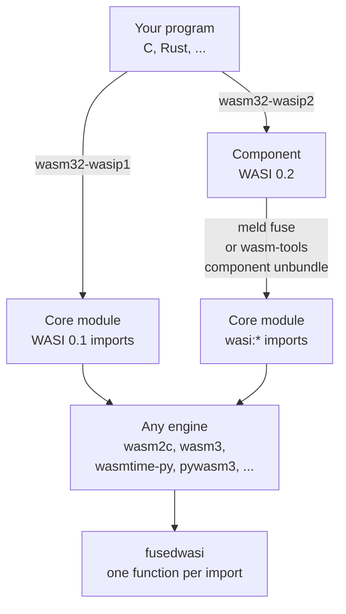
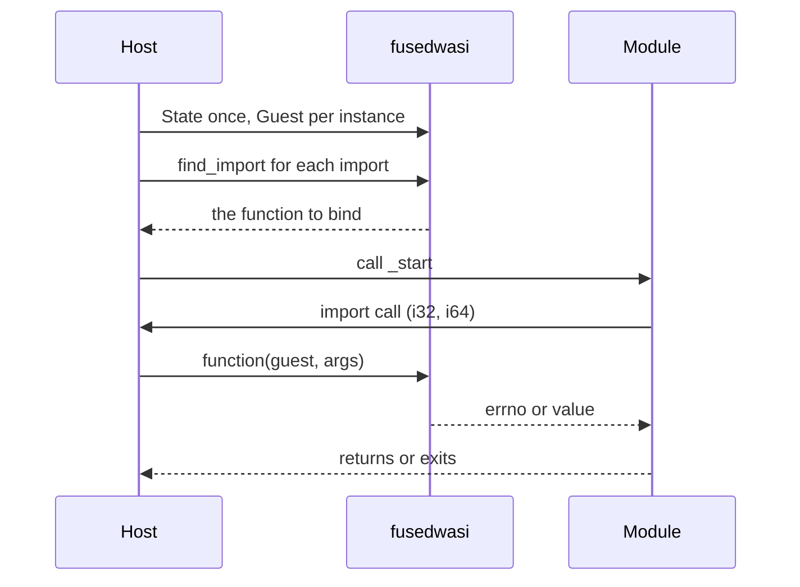

# fusedwasi

Header-only C host for the WASI Component Model, for core modules fused from components (wasm2c and other C hosts), with a Python twin.

**Alpha.** The first release is a pre-release: `pip install --pre fusedwasi`. **Unstable in the alpha: `wasi:sockets` (58 imports, IPv6 included) and `wasi:http` (63 imports, `https` in C): no promise on their behaviour or their names until a real program uses them** (`docs/host_scope.md`, "Known limits"). Two hosts, each as C headers (and the one of 0.2 with a Python twin):

* **WASI 0.2** (`fusedwasi/p2/`, `fusedwasi.p2`): all 200 imports of the command world and of `wasi:http`, in C and in Python, with the tests that run the same scenario in both and compare the outputs (POSIX and Windows).
* **WASI 0.1** (`fusedwasi/p1/`, `fusedwasi.p1`): `wasi_snapshot_preview1` and `wasi_unstable`, in C and in Python (`fusedwasi.p1.wasi_p1`, `wasi_p1_unstable`; the sockets are the four calls that answer NOTSOCK, since a program of 0.1 cannot make one). **WASI 0.1 is implemented over WASI 0.2, as Wasmtime does it: there is one state and one guest for both families.** The arguments, the environment, the standard streams, the preopens, the clocks, the random bytes and the sleep are the fields of the one `fusedwasi_p2_state`; the memory of an instance of 0.1 is memory 0 of its `fusedwasi_p2_guest`; a file or a directory opened by a module of 0.1 is a `descriptor` in the table of that state, the same resource a module of 0.2 sees in it, and the functions of 0.1 work through the operations of 0.2 (`fusedwasi_p2__fs_*`; in Python the methods of `State.filesystem`). What 0.1 keeps for itself: the rights of each descriptor, its position, the name of a preopen, and the errno table. A function of 0.1 traps like one of 0.2 (`g->trap`); the end of a call is the guest's (`proc_exit` is `wasi:cli/exit`: it leaves `exited` and `exit_code` there); `proc_raise` asks the hook `signal` of the guest and answers NOTSUP without one. The Python twin is checked against the C: the same script of calls (`tests/data/p1/*.txt`) is run by a C driver and by Python, and the lines they print are compared; the official wasi-testsuite of 0.1 runs through `tests/neutral`.

**Public and private.** The public names, in C and in Python, are listed with a line of purpose each in [`docs/public_api.md`](docs/public_api.md) (the data is `src/fusedwasi/public_api.json`, which the package carries). Every other name is private and carries a mark that cannot be missed: in C a double underscore after the prefix (`fusedwasi_p2__table_get`, `FUSEDWASI_P2__INDEX_BITS`; a private field of a public struct ends with two underscores, `state.slots__`), in Python a leading underscore (`State._slots`). A private name may change in any release and breaks nobody who stayed with the list; `tests/test_public_api.py` fails when a name of the headers is neither listed nor marked, and when a neutral user calls a private one. The top of each header has a "Host API" block with the public names defined there. What was private before is in [`docs/private_names.md`](docs/private_names.md).

## The idea

fusedwasi is the **WASI side** of a program that runs outside an engine's own WASI: it implements the functions that a WebAssembly module imports from `wasi_snapshot_preview1`, `wasi_unstable` or `wasi:*@0.2.N`, as C headers and as a Python twin, with the state they need (files, streams, clocks, random bytes, tables of handles) and nothing else: no engine, no component parser, no canonical ABI between components. The engine is the one that runs the module; it gives the library a memory and calls one function per import. That is why any engine can use it, and why Wasmtime's or uvwasi's WASI, which belong to their own engines, are not needed.

What it runs is a **core module** whose imports are WASI functions. A module built for WASI 0.1 is one already. A program built for WASI 0.2 is a *component*, which most engines for C and for Python cannot run (`wasm2c` refuses it, wasm3 and pywasm3 do not read it); the next section says how to get a core module out of it.

## Fused modules: what they are and how to get one

A **component** is the packaging of WASI 0.2: a wasm file that holds core modules and the wiring between them, in which a string or a list passes through the *canonical ABI* (a pointer and a length into a memory, the memory of whoever owns the value) and a resource is a handle. A **fused module** is the result of removing that wiring at build time: **one core module**, with one linear memory for each component that went in, in which the adapters between components are plain wasm and the imports that are left are the flat core form of the `wasi:*` functions (`wasi:cli/environment@0.2.6` `get-arguments` takes one `i32`, the pointer where the host writes the result). Such a module needs one thing from its host: those functions. `fusedwasi` has them.

There are two ways to get one; take the first when there are several components or you want one file:

| | `meld fuse` | `wasm-tools component unbundle` |
|---|---|---|
| What it does | joins one or more components into **one** core module (resolves the imports and exports between them, merges the index spaces, writes the adapters) | takes the core modules **out** of a component; nothing is joined |
| Result | `fused.wasm`, one memory for each component | one core module for each core module inside, and `rest.wasm` (the wiring, which you do not need) |
| Several components | yes | a core module for each component; the wiring is left in `rest.wasm`, so joining the modules is yours |
| Where from | [pulseengine/meld](https://github.com/pulseengine/meld) (release tarball or `cargo build --release -p meld-cli`; the packages with that name on crates.io and PyPI are other projects) | [bytecodealliance/wasm-tools](https://github.com/bytecodealliance/wasm-tools) (release tarball, `cargo install wasm-tools`) |

```sh
# a program built as a component (clang from wasi-sdk shown; Rust: cargo build --target wasm32-wasip2; or compose your own with wasm-tools component new)
clang --target=wasm32-wasip2 -O2 hello.c -o hello.component.wasm

# 1. fuse: one component or several, into one core module
meld fuse hello.component.wasm -o hello.fused.wasm
meld fuse a.component.wasm b.component.wasm -o ab.fused.wasm

# 2. or take the core modules out of a component (--threshold 0 takes all of them; by default only the ones above 10240 bytes are taken)
wasm-tools component unbundle hello.component.wasm --module-dir modules --threshold 0 -o rest.wasm
# modules/unbundled-module0.wasm is the program; the small ones next to it ("shim", "actual" imports) are the wiring of the component, not WASI

# see what the module needs from its host: every import must be one that fusedwasi has
wasm-tools print hello.fused.wasm | grep '(import'
```

This was run on a component of ours (`tests/neutral/programs/p2_command.component.wat`, with `meld 0.64.0` and `wasm-tools 1.262.0`): `meld fuse` gave one module of 2267 bytes with one memory and seven imports, all `wasi:*@0.2.6`; `unbundle --threshold 0` gave the same program as `unbundled-module0.wasm` with the same seven imports. Both ran on wasmtime-py through fusedwasi (`tests/neutral/neutral_wasmtime.py`) and wrote the same bytes and the same exit status. Every import of both was found by `fusedwasi.signatures.find_import(module, name)`, which is how a host checks a module before it runs it: a name that is not found is an import fusedwasi does not have.

Two things to know. **meld** is not stable software: `meld 0.64.0` lost a `list<string>` inside a returned `option<record>` (fixed in 0.65.0 on the component where it was seen; the evidence is in the wasmext study of the component model), and it does not keep the async ABI of WASI 0.3 (see "Not here"); check a fused module against the unfused component on Wasmtime before you rely on it. **WASI 0.1 needs none of this**: a module built for `wasm32-wasip1` is a core module with `wasi_snapshot_preview1` imports already, and fusedwasi runs it as it is.

## Using it with an engine



The engine and the library meet in the same few steps, whichever engine it is (a worked one is `tests/neutral/neutral_wasmtime.py`, about 130 lines for wasmtime-py; the C one over wasm3 is `tests/neutral/c_wasm3/neutral_wasm3.c`):



Pick by what you have:

| You have | Do |
|---|---|
| a module for WASI 0.1 (`wasm32-wasip1`) | bind its imports with `find_import`; no fuse |
| a component of WASI 0.2 | `meld fuse` it (or `unbundle` it), then as above |
| a C program that is compiled ahead of time with `wasm2c` | `#include <fusedwasi/p2/wasi_p2_cli.h>` (and the others) in the glue; `python -m fusedwasi` prints the include path |
| an embedder in C (wasm3, ...) | the same headers; the example is `tests/neutral/c_wasm3/` |
| an engine for Python | `fusedwasi.p2.State` and `Guest`; one `Instance` class per engine, `tests/neutral/neutral_wasmtime.py` is about 130 lines |
| an engine that keeps its memory out of the process | give `Guest` an object with `read(offset, length)`, `write(offset, data)` and `len()`: a call copies only the bytes it touches |

**AOT and runtime.** The library asks the engine for two things only: the memory of each component (a base and a size) and a way to call a function for each import. So it does not matter how the module runs: compiled ahead of time to C with `wasm2c` (the C headers are included into the generated glue, nothing is needed at run time), or in an interpreter or a JIT that calls the same functions through its import table (the C headers from an embedder, the Python twin from a Python host). The AOT route (`wasm2c`) is run by users outside this repository; the runtime route is run here by the neutral users in `tests/neutral/` (C over wasm3, Python over wasmtime-py and over pywasm3).

## The API (planned; the shape of the current code)

A **state** (the world), a **guest** (the caller), one flat function per import, the same arguments in C and in Python. The state holds what the guests share: the configuration, the tables of handles, the policies, the clocks. A guest holds what is one call's: the memory, the trap, the `cabi_realloc`, the end of the call (`exited`, `exit_code`). Many guests may point to one state, and nothing is rebound per call. The first argument of every function is the guest (`g` in C, `guest` in Python); its state is `g->state`. **Every C name has the prefix of the library** (`fusedwasi_` for functions and types, `FUSEDWASI_` for macros, then `p2_` for WASI 0.2): the headers are included into the C of other projects, so nothing may meet a name of the system, of another WASI host or of the user. The function of an import is `fusedwasi_` + the name that the Python twin has (`wasi_cli_environment_get_arguments`). The host gives the state what it decides (arguments, preopened directories, which sockets are allowed, the standard streams) and each guest its memory and its trap; the rest is the library.

```c
#include "wasi_p2_cli.h"             /* or wasi_p2_filesystem.h, wasi_p2_sockets.h, ... */

fusedwasi_p2_state state;            /* the world: made once, freed once, shared by the guests */
fusedwasi_p2_init(&state);           /* defaults: system clocks, /dev/urandom, nothing allowed in sockets */
state.args = args, state.arg_count = 2;

fusedwasi_p2_guest g;                /* the caller: one for each instance, made once */
fusedwasi_p2_guest_init(&g, &state); /* defaults: a trap that aborts, a wait, an exit that records and traps */
g.realloc = my_cabi_realloc;         /* the cabi_realloc of component `comp` */
g.trap = my_trap;                    /* a function that does not return: a longjmp, or what the engine has */
fusedwasi_p2_bind_memory(&g, 0, &m->data, &m->size);  /* once for each component: read at each call, so memory.grow needs no rebind */
/* or, as a convenience that keeps its own copy (set it again when the memory grows): fusedwasi_p2_set_memory(&g, 0, base, size); */

/* the body of an import of the module: the first argument is the guest, then the component whose memory it is */
fusedwasi_wasi_cli_environment_get_arguments(&g, /*comp*/ 0, /*retptr*/ ptr);

fusedwasi_p2_free(&state);           /* after the guests are done with it; the state is then closed (fusedwasi_p2_state_closed): no handle alive, none made, 0.1 answers BADF for every descriptor */
```

```python
from fusedwasi.p2 import Guest, State  # the same State and Guest serve WASI 0.1 (fusedwasi.p1.State is this class)
from fusedwasi.p2 import wasi_p2_cli as cli  # the module names follow the C headers

state = State(args=["prog"])  # the world: files, sockets, the clocks
guest = Guest(
    state, [memory], realloc=my_cabi_realloc
)  # a memory is any writable buffer, or a function of no arguments that gives it (followed when it moves), or an object with read(offset, length) / write(offset, data) / len() for an engine that keeps its memory out of the process (JavaScript, Pyodide): a call then copies only the bytes it touches
cli.wasi_cli_environment_get_arguments(guest, 0, ptr)
```

The streams and pollables belong to the state: they take the state, never a guest, and never trap (a failure is a return value), so they can be made while the state is configured, before any guest exists:

```c
fusedwasi_p2_fd_stream *out = fusedwasi_p2_fd_output_new(&state, 1);   /* NULL when there is no memory */
state.std[1] = &out->base;
```

For 0.1 the same two parts, the same types: a function is `fusedwasi_p1_<name>(&g, ...)` with the guest `g` of 0.2 (`#include "wasi_p1.h"`; the memory of the instance is `fusedwasi_p2_bind_memory(&g, 0, ...)`), it answers the errno of WASI and traps through `g.trap`. The descriptors of 0.1 are made by the first call of a function of 0.1, or by `fusedwasi_p1_open_descriptors(&state, &err, &bad)`, which tells a preopen that cannot be opened; `fusedwasi_p2_free` frees them. In Python `fusedwasi.p1.State`, `Guest` and `Exit` are the classes of `fusedwasi.p2` (`guest = Guest(state, memory)` with one memory for an instance of 0.1) and `fusedwasi.p1.wasi_p1.fd_write(guest, ...)` is the call; `State(filesystem=...)` gives the files behind both families (Python only). `fusedwasi.signatures.find_import(module, name)` gives, for an import of a core module (of 0.1, or of any `0.2.N`), the row of the table of signatures with the C symbol, the Python function (`python_function()`) and whether it takes the number of the memory (`takes_comp`).

| Part | What the host gives | What the library does |
|---|---|---|
| memory (of the guest) | a base and a size for each component, bound by pointer (`fusedwasi_p2_bind_memory`, primary: read at each access, so a moved base is followed) or set by value (`fusedwasi_p2_set_memory`, the convenience) | checked, little-endian loads and stores; a pointer outside is a trap. (Python only: a memory that lives outside the process is an object with `read`/`write`/`len`, copied per access; C keeps its memory by pointers.) |
| handles | nothing | the table of `own` and `borrow` (generation + index), `[resource-drop]` |
| lists and strings it returns | `realloc` of the guest (the `cabi_realloc` of the component) | placing them in the guest's memory |
| files | the preopened directories (`path`, `name`, `writable`); Python: optionally `filesystem=` | paths confined below the preopen (POSIX and Windows) |
| sockets | `socket_addr_check`, `allow_ip_name_lookup`; refused by default | TCP, UDP, name lookup (POSIX and Winsock) |
| http | `http_check`, `http_send`; refused by default | an HTTP/1.1 client of its own (TLS in Python only), the types of `wasi:http` |
| time, random (state); trap, exit, wait, signal (guest) | a hook, or the system's own | the rest |

**Integers are unsigned**, parameters and results, in C (`uint32_t`, `uint64_t`) and in Python: an offset, a length or a handle is 0 to 2**32 - 1, an `i64` 0 to 2**64 - 1. An engine that hands its values over as signed (the Python bindings of wasmtime and wasm3 do) masks every argument by its width (`x & 0xFFFFFFFF`, `x & 0xFFFFFFFFFFFFFFFF`) and re-signs a result if it wants the range of its own type (`x - 2**32 if x >= 2**31`); the functions do not do it, and a negative offset is outside the memory.

Every function is `static inline` and nothing is global or thread-local, so a module links only what it imports and several instances (and several guests of one state) can live in a process.

## The headers come with the Python package

`pip install fusedwasi` (or a dependency on it) gives the headers too: `python -m fusedwasi` prints the directory to put on the include path, `fusedwasi.get_include()` gives it in Python, and the C is then `#include <fusedwasi/p2/wasi_p2_cli.h>`. With CMake, from a source checkout or the sdist (the wheel carries the headers but not the CMake files): `cmake -S . -B build && cmake --install build`, then `find_package(fusedwasi)` and the target `fusedwasi::headers`. The headers of the wheel and of the CMake install are the same files (`src/fusedwasi/include/`).

## Who uses it

Any host that can give a memory and call a function for each import. In C: the glue of a module compiled with `wasm2c` includes the headers and needs nothing at run time. In Python: the twin in `.py` under the engines a Python host supports. The library knows nothing of the host that calls it: three small neutral hosts in `tests/neutral/` (C over wasm3, Python over wasmtime-py and over pywasm3) show that the public names are enough.

## Not here

Components made of components (the fuse does that), WASI 0.3 and async, an engine, a parser of WIT.

WASI 0.3 is not supported. If it is ever added through `meld fuse`, the support will be **partial**: meld 0.65 does not keep the async part of the canonical ABI (the `[async-lower]` imports are renamed or replaced by meld-private ones, two fused async components leave a dangling import, `--component` refuses async). Full p3 waits until meld keeps the standard async ABI.
